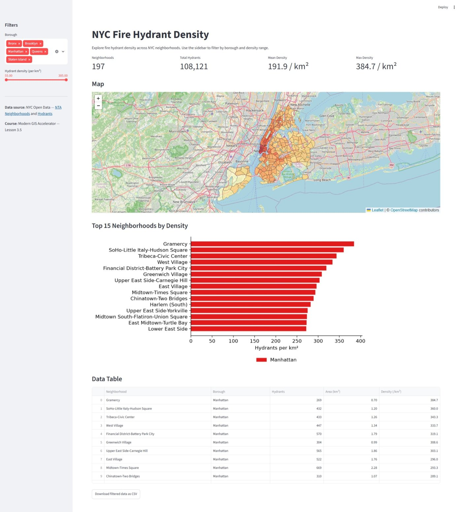
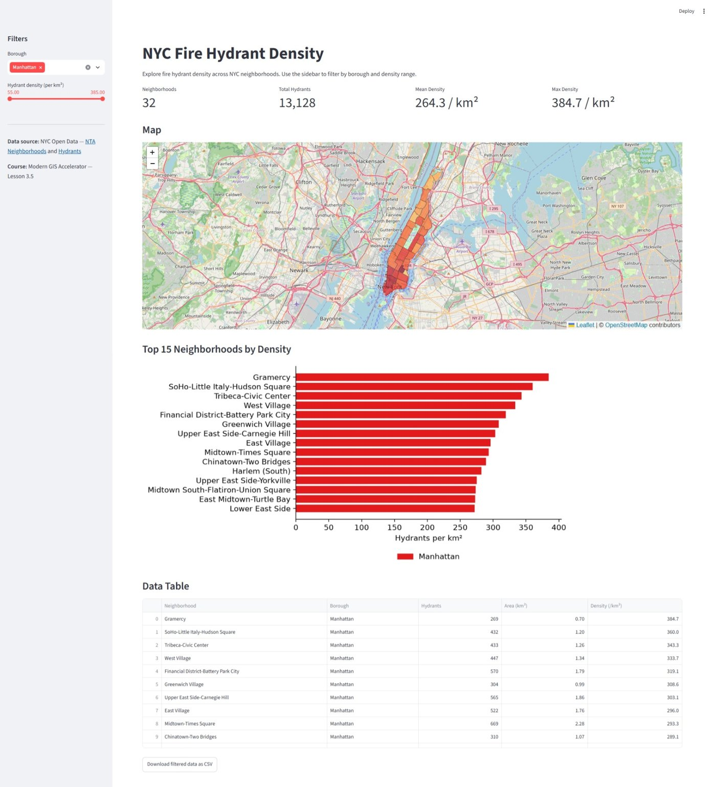

# NYC Fire Hydrant Density Dashboard

An interactive Streamlit dashboard that explores fire hydrant density across New York City's residential neighborhoods. Filter by borough and density range, and the map, summary metrics, top-15 chart and data table all update together.

**Live app:** https://nyc-hydrant-dashboard-bgis.streamlit.app/ (free Streamlit Community Cloud hosting; if it has been idle, it may take a moment to wake up)



*All boroughs selected: 197 neighborhoods and 108,121 hydrants.*



*Filtered to Manhattan: 32 neighborhoods, 13,128 hydrants.*

## Features

- **Sidebar filters:** borough multiselect and a density range slider
- **Live metrics:** neighborhoods, total hydrants, mean density, max density
- **Choropleth map:** Folium map colored with the same yellow-to-dark-red ramp as my companion [MapLibre map](https://burlesongis.github.io/nyc-hydrant-map/); hover for name, borough, hydrant count and density
- **Top 15 chart:** horizontal bar chart of the densest neighborhoods in the current filter, colored by borough
- **Sortable table** and a **CSV download** of exactly what is currently filtered

## Run locally

```bash
pip install -r requirements.txt
python -m streamlit run app.py
```

The app opens at http://localhost:8501.

## Data and a correction worth knowing about

`data.parquet` is a GeoParquet of the 262 NYC 2020 Neighborhood Tabulation Areas (NTAs) with hydrant counts per neighborhood. The dashboard shows the 197 residential NTAs (`ntatype = '0'`) that contain 108,121 hydrants.

The starting data from the course had `area_km2` calculated in Web Mercator (EPSG:3857), which stretches areas in NYC by about 1.74x and understates every density by the same factor. I recomputed the areas in NY State Plane (EPSG:2263) and checked them against the NTA file's own `shape_area` (they agree to four decimals). For example, Gramercy is 0.70 km² and 384.7 hydrants/km², not 1.22 km² and 220.7.

| Check | Course data | Corrected |
|---|---|---|
| Gramercy density | 220.7 / km² | 384.7 / km² |
| Mean density (197 residential NTAs) | 110.1 / km² | 191.9 / km² |

Hydrant counts are unchanged.

## Changes from the course starter code

- Basemap switched from CARTO tiles (now requires an API key) to OpenStreetMap
- Density slider ends rounded to the step size; otherwise the top handle snapped below the maximum and silently hid the densest neighborhood
- Added the top-15 bar chart and the CSV download button

## Files

```
app.py            Streamlit application
data.parquet      neighborhoods + hydrant density (GeoParquet)
requirements.txt  Python dependencies
images/           screenshots
```

## Data sources

- [NYC Open Data: Hydrants](https://data.cityofnewyork.us/Environment/Hydrants/5bgh-vtsn)
- [NYC Open Data: 2020 Neighborhood Tabulation Areas](https://data.cityofnewyork.us/City-Government/2020-Neighborhood-Tabulation-Areas-NTAs-/9nt8-h7nd)
- Basemap: © OpenStreetMap contributors

## Credits

Built by Dana Burleson as part of Matt Forrest's Modern GIS Accelerator course (Lesson 3.5).
